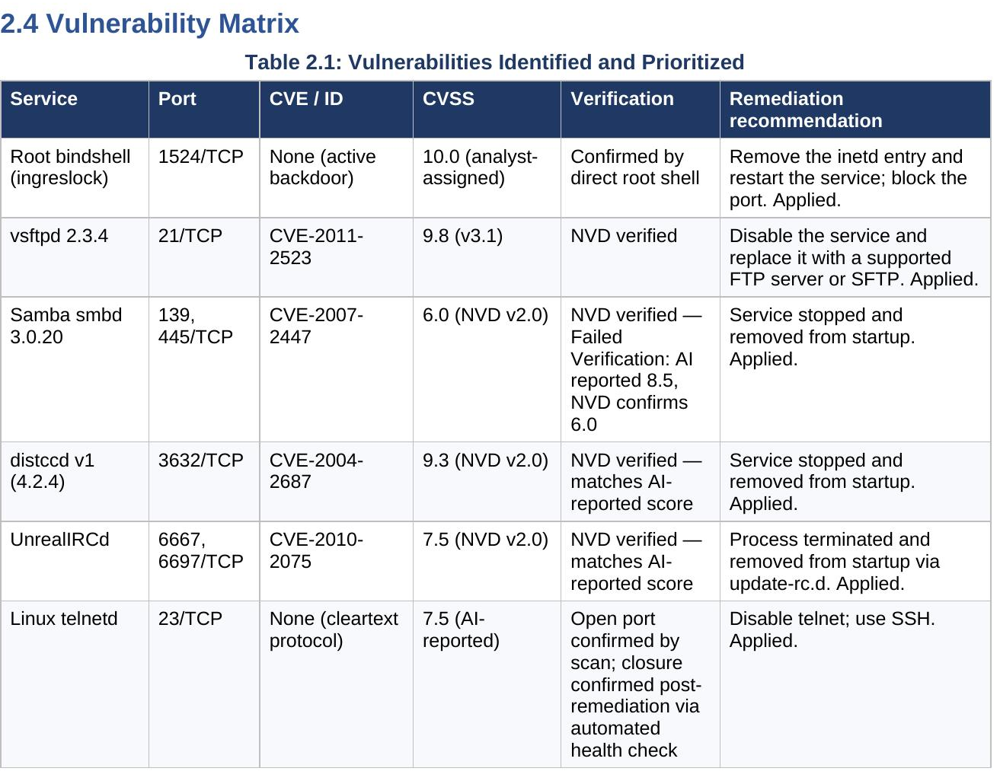
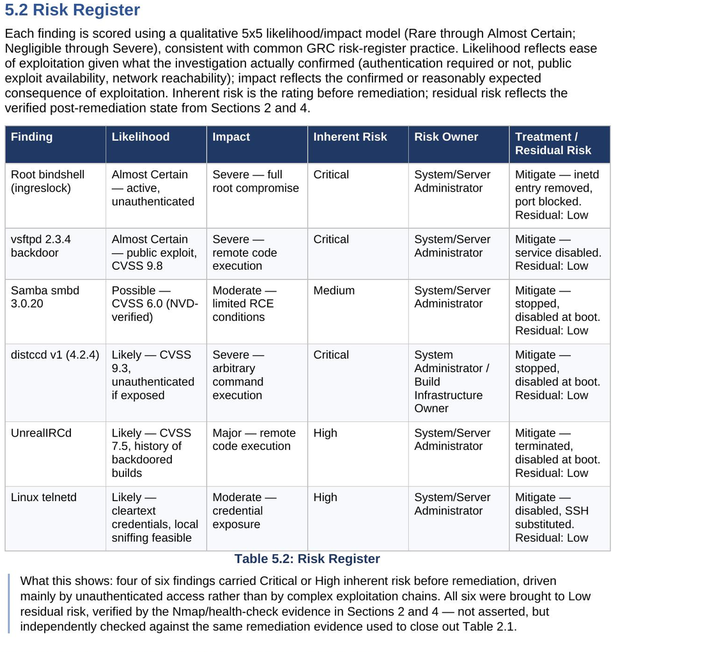
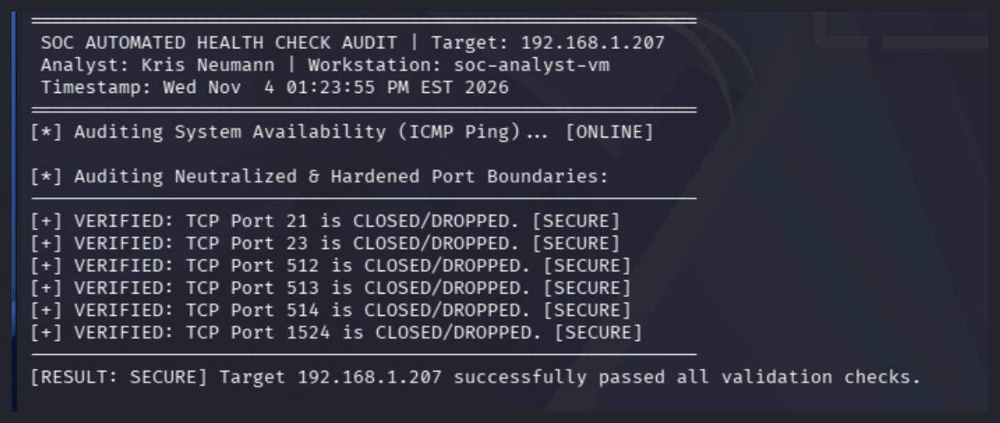

# Incident Response Investigation: The Legacy Server Breach

**Author:** Kristopher Neumann

A structured incident-response investigation of a deliberately vulnerable
legacy Ubuntu server, conducted end-to-end in an isolated virtual lab
across the incident response lifecycle: **Preparation → Detection &
Analysis → Containment → Eradication & Recovery → Post-Incident Review**.
Every technical finding was verified against authoritative sources before
being treated as fact, including findings sourced from AI-assisted
research, and every finding was mapped to NIST, CIS, and ISO 27001
controls with a risk rating and an owner.

[]()
[]()
[]()
[]()

## Executive summary

* **Business & risk outcome:** Remediated six critical-to-medium host exposures across an unmanaged legacy Ubuntu server, reducing overall residual risk from **Critical** to **Low** and mapping all findings to **NIST CSF 2.0, SP 800-53 Rev 5, CIS Controls v8, and ISO/IEC 27001:2022**.
* **Root-cause governance gaps:** Traced all six technical vulnerabilities back to four systemic policy failures—absence of patch management, asset inventory, hardening baselines, and change management—and delivered a prioritized **Risk Register** (`docs/risk_register.csv`) with assigned owners.
* **Technical containment & verification:** Performed live incident containment without destroying volatile evidence (`iptables`, service isolation), eradicated backdoor persistence (`vsftpd 2.3.4`, port `1524` bindshell), and built an automated Bash verification audit (`scripts/health_check.sh`) to prove control effectiveness.
* **Disciplined AI governance:** Enforced a strict independent-verification rule for all AI-assisted threat research—catching and logging a hallucinated CVSS score (`8.5` vs. NVD's authoritative `6.0` on `CVE-2007-2447`) before reporting.

## Why this project

I spent several years in technical recruiting, evaluating engineers and
learning what strong technical work actually looks like, before moving
into hands-on security work through a structured cybersecurity training
program. This project is where that transition shows up directly: the
investigation itself, and the discipline of verifying every claim rather
than trusting it on its face.

## The engagement

A legacy Ubuntu server (hostname `legacyserver`) running a deliberately
vulnerable configuration triggered anomalous traffic alerts in a
simulated SOC scenario. Acting as the responding analyst, I built an
isolated lab, investigated the breach, contained it without destroying
evidence, eradicated the root cause, and hardened the system against
recurrence — then documented the findings as a formal technical report
with an automated verification script.

## Key findings

| Finding | Detail |
|---|---|
| **Unauthenticated root bindshell** | Port 1524 ran a root shell via an `inetd` service entry — no authentication, no exploit required. |
| **Backdoored FTP service** | vsftpd matching the known-malicious 2.3.4 build (CVE-2011-2523, CVSS 9.8) — verified against NIST NVD, not taken on AI output alone. |
| **30 open ports** on a single host, including legacy/unencrypted services (telnet, plain FTP), an exposed build service (distcc), outdated Samba, and two unsupported databases. |
| **Surgical containment** | Blocked the two most critical listeners with host firewall rules and process termination — without powering off the host or destroying volatile evidence. |
| **Permanent remediation** | Removed the backdoor's `inetd` persistence mechanism, stopped and disabled Samba and distccd at the service level, and hardened four additional legacy remote-access services. |
| **Automated verification** | Wrote and ran a Bash health-check script (`scripts/health_check.sh`) to confirm the fixes hold. |

## From findings to risk — the GRC layer

Sections 1–4 document what was wrong and how each finding was fixed.
Section 5 goes one level up: it maps every finding to formal control
frameworks, scores risk, and traces the root cause back to the process
gaps that let six vulnerabilities coexist on one host — not just the
per-finding patch.

- **Framework mapping** — every finding is mapped to NIST CSF 2.0, NIST
  SP 800-53 Rev 5, CIS Controls v8, and ISO/IEC 27001:2022 Annex A. The
  mapping shows the six findings aren't six unrelated problems — they
  trace back to two recurring control gaps (secure configuration/least
  functionality, and vulnerability/flaw remediation).
- **Risk register** — each finding scored by likelihood and impact, rated
  from Medium to Critical before remediation, with an assigned risk
  owner and treatment decision, down to a verified Low residual risk.
- **Root-cause / policy gap analysis** — four process-level failures
  (no patch management program, no asset inventory, no hardening
  baseline, no change management review) that explain why all six
  findings existed on the same host at once.
- **Post-incident review** — a lessons-learned pass on the investigation
  process itself, including a process gap it catches in its own earlier
  work: UnrealIRCd's remediation was initially incomplete (terminated
  but not disabled at boot) until a follow-up step closed it.

**Vulnerability matrix** (every finding, CVE/CVSS, and the control gap it maps to):



**Risk register** (likelihood × impact, owner, treatment, residual risk):



Full writeup: [docs/Section_5_Post_Incident_Review.pdf](docs/Section_5_Post_Incident_Review.pdf) | Machine-readable register: [docs/risk_register.csv](docs/risk_register.csv)

## Remediation & verification

A sample of the actual commands run against the target during eradication, pulled directly from
the report (full sequence, including containment firewall rules and attack-surface reduction, is
in [`docs/Section_3_Containment.pdf`](docs/Section_3_Containment.pdf) and
[`docs/Section_4_Eradication_Recovery.pdf`](docs/Section_4_Eradication_Recovery.pdf)):

```bash
# Permanently disable the backdoored FTP service and root bindshell (both launched via inetd)
sed -i '/ftp/s/^/#/' /etc/inetd.conf
sed -i '/ingreslock/s/^/#/' /etc/inetd.conf
sed -i '/1524/s/^/#/' /etc/inetd.conf
killall -9 vsftpd 2>/dev/null
/etc/init.d/openbsd-inetd restart

# Stop and disable Samba, distccd, and UnrealIRCd (standalone daemons, not inetd-launched)
/etc/init.d/samba stop && update-rc.d -f samba remove
/etc/init.d/distcc stop && update-rc.d -f distcc remove
pkill -f unrealircd && update-rc.d -f unrealircd remove
```

### Automated port verification (`scripts/health_check.sh`)

<details>
<summary>View script</summary>

```bash
#!/bin/bash
#
# health_check.sh
# Automated Health Check — Incident Response Investigation: The Legacy Server Breach
#
# Verifies that the services remediated during the incident response
# (vsftpd backdoor, root bindshell, unnecessary rsh-family/telnet services,
# Samba, distccd, and UnrealIRCd) remain closed after remediation.
#
# Author: Kristopher Neumann
#
# Usage:
#   ./health_check.sh [target_ip]
#   If no target_ip is given, defaults to the value below.

TARGET_IP="${1:-192.168.1.207}"
CRITICAL_PORTS=(21 23 512 513 514 1524 139 445 3632 6667 6697)
TIMEOUT=2
FAILED_CHECKS=0

echo "=============================================="
echo " AUTOMATED HEALTH CHECK AUDIT | Target: ${TARGET_IP}"
echo " Analyst: Kristopher Neumann | Workstation: soc-analyst-vm"
echo " Timestamp: $(date)"
echo "=============================================="

echo -n "[*] Auditing System Availability (ICMP Ping)... "
if ping -c 2 -W 2 "${TARGET_IP}" > /dev/null 2>&1; then
    echo "[ONLINE]"
else
    echo "[CRITICAL: HOST UNREACHABLE]"
    exit 1
fi

echo ""
echo "[*] Auditing Neutralized & Hardened Port Boundaries:"
echo "----------------------------------------------"

for PORT in "${CRITICAL_PORTS[@]}"; do
    nc -z -w "${TIMEOUT}" "${TARGET_IP}" "${PORT}" > /dev/null 2>&1
    if [ $? -eq 0 ]; then
        echo "[-] ALERT: TCP Port ${PORT} is OPEN! [VULNERABLE / UNHARDENED]"
        FAILED_CHECKS=$((FAILED_CHECKS + 1))
    else
        echo "[+] VERIFIED: TCP Port ${PORT} is CLOSED/DROPPED. [SECURE]"
    fi
done

echo "----------------------------------------------"
if [ ${FAILED_CHECKS} -eq 0 ]; then
    echo "[RESULT: SECURE] Target ${TARGET_IP} successfully passed all validation checks."
    exit 0
else
    echo "[RESULT: NON-COMPLIANT] ${FAILED_CHECKS} unauthorized services detected!"
    exit 1
fi
```

</details>

Actual run against the target, confirming every remediated port is closed:



## AI as a force multiplier — with verification

Generative AI was used throughout as a research and drafting assistant,
under a strict rule: **every AI-sourced claim had to be independently
verified** before it went in the report.

A concrete example from this investigation: an AI assistant returned a
threat-intelligence profile that included a CVSS score of 8.5 for a
Samba vulnerability (CVE-2007-2447). Cross-referencing that score against
the NIST National Vulnerability Database turned up a different number —
NVD's own CVSS v2.0 score for that CVE is 6.0. Rather than quietly using
whichever number looked better, the discrepancy was logged in the report
as a **Failed Verification**, and the lower, authoritative score was the
one used going forward. That's the actual behavior this project is built
around: using AI to move faster without treating it as ground truth.

## Lessons learned

CompTIA's incident response model names this final step **Lessons
Learned**; this project documents the same step as **Post-Incident
Review** (Section 5), following NIST SP 800-61 Rev. 2's grouping of
detection/analysis and eradication/recovery into combined phases rather
than CompTIA's seven discrete steps — same step, different framework's
label.

- **Persistence checks need to be explicit, not assumed.** UnrealIRCd
  was initially stopped with `pkill`, which looked complete from a
  running-process check — but it was still re-registered to launch at
  boot. The gap wasn't caught until a dedicated persistence check, and
  was then closed with `update-rc.d`. Every eradicated service now gets
  a boot-persistence check, not just a process check.
- **AI output needs independent verification, every time.** An
  AI-sourced CVSS score for a Samba CVE (8.5) didn't match NVD's
  authoritative score (6.0) for the same CVE. The discrepancy was
  logged rather than silently corrected, and the authoritative figure
  is the one used in the report.
- **Lab isolation needs to be verified, not configured once and
  trusted.** An early network configuration briefly bridged the lab
  onto the host's own network; this was caught and the lab was rebuilt
  on a properly isolated virtual network before continuing.

```text
Incident_Response_Investigation/
├── README.md
├── docs/                          # Section-by-section incident report & GRC register
│   ├── Section_1_Preparation.pdf
│   ├── Section_2_Detection_Analysis.pdf
│   ├── Section_3_Containment.pdf
│   ├── Section_4_Eradication_Recovery.pdf
│   ├── Section_5_Post_Incident_Review.pdf
│   └── risk_register.csv
├── evidence/                      # Annotated screenshots, by section
│   └── ...
├── scripts/
│   └── health_check.sh            # Automated post-remediation verification
└── logs/                          # Raw tool output (scans, process lists, connections)
    └── ...
```

## Skills demonstrated

- Network segmentation and isolated lab design (UTM/QEMU)
- Reconnaissance and service enumeration (`nmap`, NSE scripts)
- Vulnerability research and CVE/CVSS verification against NVD
- Incident containment with evidence preservation (order of volatility)
- Linux system hardening (`inetd`, `iptables`, service minimization, `update-rc.d`)
- Bash scripting for automated security verification
- Technical documentation and incident reporting
- Disciplined, verification-first use of AI tooling
- Control framework mapping (NIST CSF 2.0, NIST SP 800-53, CIS Controls v8, ISO/IEC 27001:2022)
- Risk assessment and risk register development (likelihood/impact scoring, ownership, treatment)
- Root-cause and policy/control gap analysis
- Post-incident review per NIST SP 800-61 Rev. 2

## Lab note

This investigation was performed entirely inside an isolated virtual lab
using intentionally vulnerable training VMs. No production systems, real
organizations, or real-world targets were involved. The lab network was
later rebuilt on a properly isolated virtual network — a correction made
and documented during the investigation itself.

## Contact

Kristopher Neumann — www.linkedin.com/in/krisneumann
